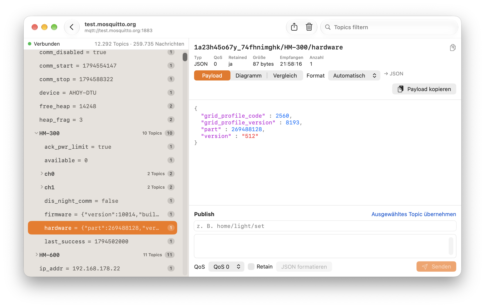

# Canopy

Ein nativer MQTT-Client für macOS, geschrieben in Swift und SwiftUI.
Canopy verbindet sich mit einem MQTT-Broker (z. B. Mosquitto), sortiert alle empfangenen
Nachrichten anhand ihrer Topic-Struktur in einen Baum und zeigt die Payload in
verschiedenen Formaten an.



## Funktionen

**Verbindungen**
- Gespeicherte Verbindungen (Favoriten) mit Name, Host, Port, Benutzername und Passwort,
  Client-ID, Keep-Alive, Clean Session und beliebig vielen Abonnements inkl. QoS
- MQTT 3.1.1 und MQTT 5
- Transporte `mqtt://`, `mqtts://`, `ws://`, `wss://`
- TLS mit eigener CA, optional ohne Zertifikatsprüfung (selbstsignierte Broker)
- Client-Zertifikate (mTLS)
- Passwörter und private Schlüssel liegen im macOS-Schlüsselbund
- Mehrere Verbindungen gleichzeitig: jedes Fenster (⌘N) hat eine eigene Verbindung

**Topic-Baum**
- Hierarchische Darstellung aller Topics mit Wert-Vorschau, Topic- und Nachrichtenzählern
- Filter über Topic und Payload
- Statuszeile mit Verbindungsstatus; bei Fehlern mit vollständiger Meldung und „Erneut verbinden“
- Kontextmenü: Topic/Payload kopieren, Exportieren, Retained-Nachrichten löschen
  (einzeln oder für einen ganzen Teilbaum)
- Das zuletzt ausgewählte Topic wird pro Verbindung gemerkt und beim nächsten Verbinden
  wieder angezeigt

**Nachrichten**
- Formate: Automatisch, Raw/Text, JSON und XML (formatiert, mit Syntax-Highlighting),
  Hex-Dump, Base64, Binär, Dezimal
- Metadaten (QoS, Retained, Größe, Zeit) und MQTT-5-Properties (Content-Type,
  Response-Topic, Correlation-Data, User Properties …)
- Verlauf der letzten 300 Nachrichten pro Topic
- Diagramm für Zahlenwerte, auch für Zahlen innerhalb von JSON-Payloads
- Vergleich (Diff) zweier Nachrichten
- Export als JSON oder CSV
- Nachrichten senden (Topic, Payload, QoS, Retain, bei MQTT 5 mit Properties)

**Oberfläche**
- Fensterposition und -größe sowie alle Trennlinien (Baum ↔ Details, Payload ↔ Verlauf,
  Details ↔ Senden) werden gespeichert; Doppelklick auf eine Trennlinie setzt sie zurück

## Voraussetzungen

- macOS 27.2 oder neuer
- zum Selbstbauen: Xcode 27.2 oder neuer

Abhängigkeit (wird von Xcode automatisch per Swift Package Manager geladen):
[CocoaMQTT](https://github.com/emqx/CocoaMQTT) 2.4.x

## Installation

Eine fertige Version gibt es auf der Seite [Releases](https://github.com/dirkclemens/canopy/releases/latest)
als `Canopy.dmg` (ad-hoc signiert, nur Apple Silicon). Da sie nicht von Apple notarisiert ist,
blockiert macOS den ersten Start. Nach dem Kopieren nach `/Applications` das
Quarantäne-Attribut entfernen:

```sh
xattr -dr com.apple.quarantine /Applications/Canopy.app
```

## Bauen und starten

1. `Canopy.xcodeproj` in Xcode öffnen
2. Unter *Signing & Capabilities* ggf. das eigene Team auswählen
3. Schema **Canopy** wählen und mit ⌘R starten

Oder auf der Kommandozeile:

```sh
xcodebuild -project Canopy.xcodeproj -scheme Canopy -configuration Release build
```

### Schnelltest mit einem lokalen Broker

```sh
brew install mosquitto
mosquitto -v                                   # lauscht auf localhost:1883
mosquitto_pub -t home/livingroom/temp -m 21.5 -r
mosquitto_pub -t home/sensor -m '{"temp": 20.1, "hum": 55}'
```

In Canopy eine Verbindung zu `localhost`, Port `1883` anlegen und verbinden.

## Tests

Die Tests verwenden Swift Testing und laufen in Xcode mit ⌘U oder per

```sh
xcodebuild -project Canopy.xcodeproj -scheme Canopy -destination 'platform=macOS' test
```

Die Integrationstests (MQTT 3.1.1/5, Retained-Nachrichten, TLS, mTLS) brauchen einen
lokalen Broker und werden sonst übersprungen. Start aus dem Projektverzeichnis:

```sh
mosquitto -c CanopyTests/Fixtures/mosquitto-test.conf
```

Die Test-Zertifikate in `CanopyTests/Fixtures/` sind nur für Tests gedacht. macOS akzeptiert
Server-Zertifikate nur mit höchstens 398 Tagen Laufzeit; erneuert werden sie mit
`CanopyTests/Fixtures/make-certs.sh`.

## Projektstruktur

```
Canopy/
├── CanopyApp.swift, ContentView.swift  App-Einstieg, ein Verbindungs-Service pro Fenster
├── AppIcon.icon/                       App-Icon (Icon Composer, SVG-Ebenen)
├── Models/                             Verbindungsprofil, Nachrichten, Topic-Baum,
│                                       Payload-Formatierung, Highlighting, Diff, Export
├── Services/                           MQTT-Client (3.1.1/5), Zertifikate, Speicherung, Schlüsselbund
└── Views/                              Verbindungsverwaltung, Topic-Baum, Details, Diagramm,
                                        Vergleich, Senden, Split-Views
CanopyTests/                            Unit- und Integrationstests, Test-Zertifikate
TASKS.md                                Ablaufplan und offene Punkte
```

## Datenspeicherung

- Verbindungen: `~/Library/Containers/de.adcore.Canopy/Data/Library/Application Support/Canopy/connections.json`
  (ohne Passwörter und private Schlüssel)
- Passwörter und private Schlüssel: macOS-Schlüsselbund (Dienst `de.adcore.Canopy.connection`)
- Fenster- und Ansichtseinstellungen: UserDefaults der App

## Einschränkungen

- Private Schlüssel für mTLS: nur RSA im PEM-Format (PKCS#1 oder unverschlüsseltes PKCS#8);
  PKCS#12-Dateien und verschlüsselte Schlüssel werden noch nicht unterstützt
- Payloads über 200 KB werden ohne Syntax-Highlighting angezeigt

Weitere geplante Punkte stehen in [TASKS.md](TASKS.md).

## Lizenz

[PolyForm Noncommercial License 1.0.0](LICENSE) – Nutzung, Änderung und Weitergabe sind
für nicht-kommerzielle Zwecke erlaubt. Copyright 2026 Dirk Clemens.
